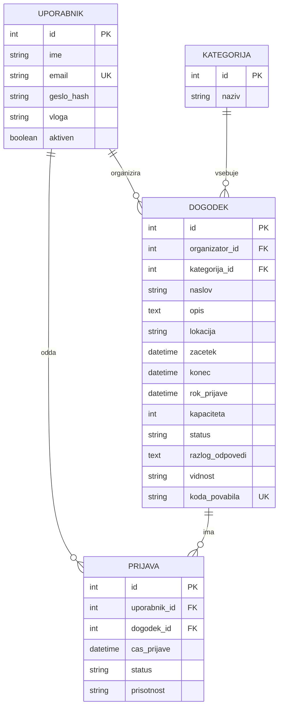

# EventTide – podatkovni model

Podatki bodo shranjeni v relacijski podatkovni bazi.

## ER-diagram

PK pomeni primarni ključ, FK tuji ključ, UK pa enolično vrednost.

Vsak dogodek ima enega organizatorja in eno kategorijo. Uporabnik in dogodek sta povezana prek entitete Prijava, ki hrani status prijave in prisotnost. Kombinacija uporabnik_id in dogodek_id mora biti enolična.

## Entitete in glavna polja

### Uporabnik
- id – primarni ključ
- ime
- email – enoličen
- geslo_hash – varno zgoščeno geslo
- vloga – udeleženec, organizator ali administrator
- aktiven – stanje računa

### Kategorija
- id – primarni ključ
- naziv – npr. izobraževanje, šport ali umetnost

### Dogodek
- id – primarni ključ
- organizator_id – tuji ključ na uporabnika
- kategorija_id – tuji ključ na kategorijo
- naslov
- opis
- lokacija
- zacetek
- konec
- rok_prijave
- kapaciteta
- status – osnutek, objavljen, odpovedan ali umaknjen
- razlog_odpovedi – neobvezno pojasnilo odpovedi ali umika
- vidnost – javen ali zaseben
- koda_povabila – enolična naključna koda za zasebni dogodek; pri javnem dogodku je prazna

### Prijava
- id – primarni ključ
- uporabnik_id – tuji ključ na uporabnika
- dogodek_id – tuji ključ na dogodek
- cas_prijave
- status – potrjena, cakalna ali odpovedana
- prisotnost – neevidentirana, prisoten ali odsoten

## Povezave med entitetami

- En organizator lahko ustvari več dogodkov. Vsak dogodek ima enega organizatorja.
- Ena kategorija lahko vsebuje več dogodkov. Vsak dogodek pripada eni kategoriji.
- En uporabnik ima lahko več prijav. Vsaka prijava pripada enemu uporabniku.
- En dogodek ima lahko več prijav. Vsaka prijava se nanaša na en dogodek.

Entiteta Prijava povezuje uporabnike in dogodke ter hrani status prijave in prisotnost.

## Osnutek podatkovnega modela

- Uporabnik (1) → (N) Dogodek: en organizator ustvari več dogodkov.
- Kategorija (1) → (N) Dogodek: ena kategorija vsebuje več dogodkov.
- Uporabnik (1) → (N) Prijava: en uporabnik odda več prijav.
- Dogodek (1) → (N) Prijava: en dogodek ima več prijav.

## Osnovna pravila

- Kombinacija uporabnik_id in dogodek_id je enolična. Ob ponovni prijavi se posodobi obstoječi zapis.
- Število potrjenih prijav ne sme preseči kapacitete dogodka.
- Vrstni red čakalnega seznama določa čas prijave; ob enakem času odloča id prijave.
- Prisotnost se evidentira samo pri potrjenih prijavah.
- Podatkovni model prikazuje osnovo za MVP. Za dodatne funkcionalnosti se pozneje razširi.
