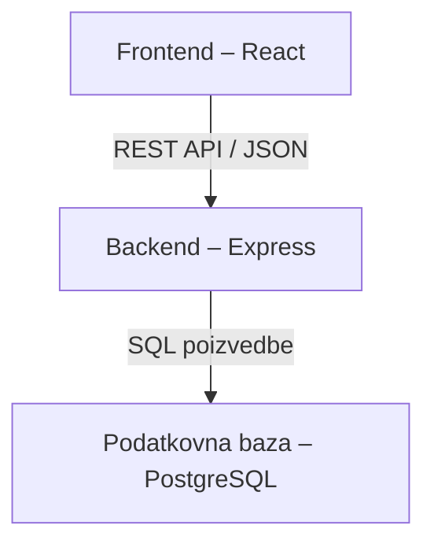

# EventTide – arhitektura in tehnološki sklad

## Arhitektura

Aplikacija bo sestavljena iz treh glavnih delov:

- Frontend prikazuje dogodke, obrazce in uporabniške preglede.
- Backend obdeluje zahteve, preverja uporabniške pravice in izvaja pravila prijavljanja.
- Podatkovna baza shranjuje uporabnike, kategorije, dogodke in prijave.

Frontend bo z backendom komuniciral prek REST API-ja v obliki JSON. Backend bo dostopal do podatkovne baze in vračal rezultate frontendu.

### Diagram arhitekture

## Tehnološki sklad

- Frontend: React in CSS za uporabniški vmesnik.
- Backend: Node.js in Express za REST API ter poslovno logiko.
- Podatkovna baza: PostgreSQL.
- Avtentikacija: strežniške seje in bcrypt za zgoščevanje gesel.
- Lokalni razvoj: Visual Studio Code, Vite in Docker Compose za podatkovno bazo.
- Upravljanje kode: Git.

## Avtentikacija in uporabniške pravice

Uporabnik se prijavi z e-poštnim naslovom in geslom. Gesla se shranjujejo v zgoščeni obliki. Po uspešni prijavi backend ustvari sejo, brskalnik pa prejme sejni piškotek HttpOnly.

Nov uporabnik dobi vlogo udeleženca. Administrator lahko dodeli vlogo organizatorja. Prvi administratorski račun se ustvari z začetno skripto.

Backend pri vsaki zaščiteni zahtevi preveri uporabnikovo vlogo in lastništvo podatkov. Organizator lahko na primer ureja samo svoje dogodke.

## Lokalni zagon

1. Namestimo odvisnosti z ukazom `npm install` v mapah frontenda in backenda.
2. V datoteki `.env` nastavimo povezavo do baze, skrivnost sej in dovoljen naslov frontenda.
3. Podatkovno bazo zaženemo z ukazom `docker compose up -d`.
4. Izvedemo pripravljeno skripto za ustvarjanje tabel in začetnega administratorja.
5. Backend in frontend zaženemo z ukazom `npm run dev` v njunih mapah.
6. Aplikacijo odpremo na lokalnem naslovu, ki ga izpiše Vite.

## Utemeljitev arhitekturnih odločitev

- React sem izbral, ker omogoča ponovno uporabo komponent, kot so kartice dogodkov in obrazci, ter prikaz sprememb brez ponovnega nalaganja celotne strani.
- Node.js in Express sem izbral, ker lahko uporabljam JavaScript na frontendu in backendu. Express omogoča preprosto izdelavo REST API-ja.
- PostgreSQL sem izbral, ker so uporabniki, dogodki in prijave med seboj povezani. Podpira tudi transakcije, s katerimi bom preprečil prekoračitev kapacitete pri sočasnih prijavah.
- Frontend in backend sem ločil, da bo koda preglednejša in bom lahko uporabniški vmesnik razvijal ločeno od poslovne logike.
- Strežniške seje sem izbral za upravljanje prijavljenih uporabnikov, bcrypt pa za varno zgoščevanje gesel.
- Vite sem izbral za hitro pripravo in lokalni razvoj React aplikacije.
- Docker Compose sem izbral za preprost zagon podatkovne baze z enakimi nastavitvami na različnih računalnikih.
- Git sem izbral za spremljanje sprememb in možnost vrnitve na prejšnje različice kode.
