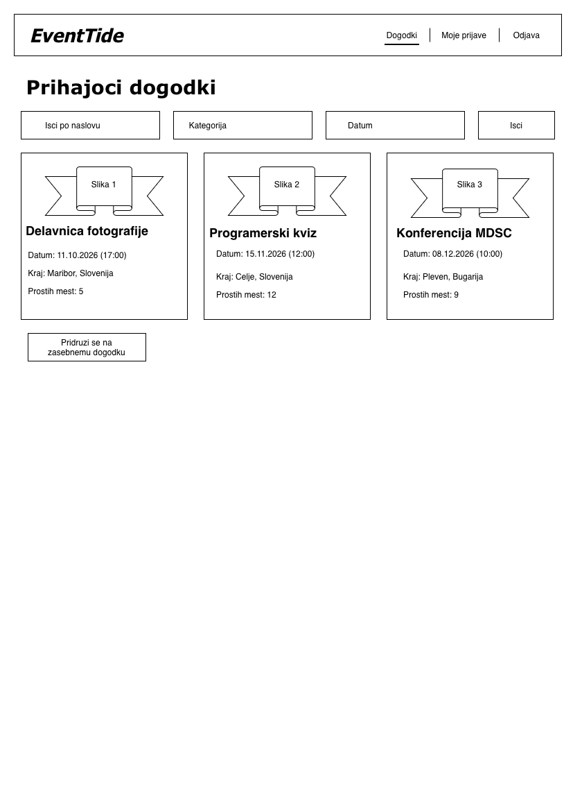
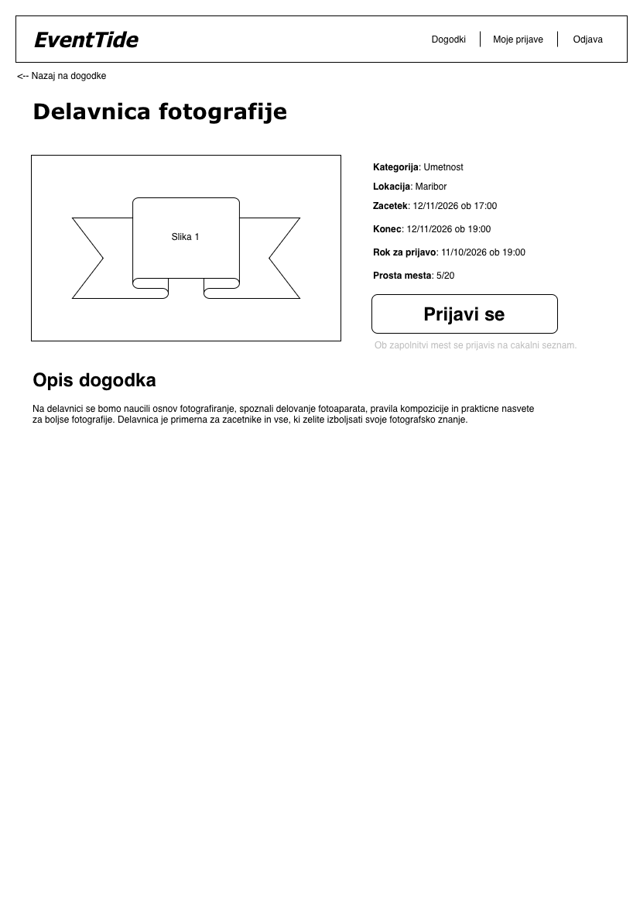
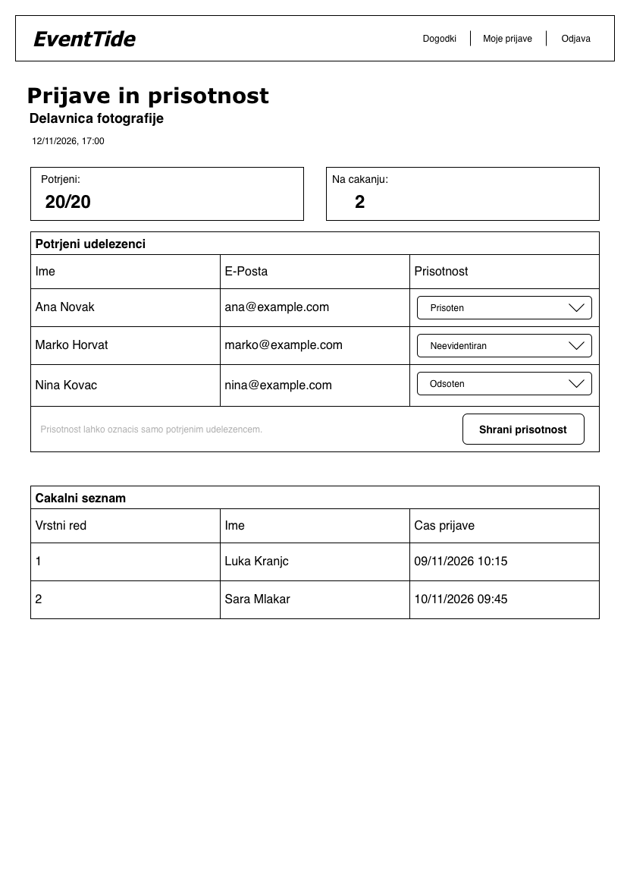
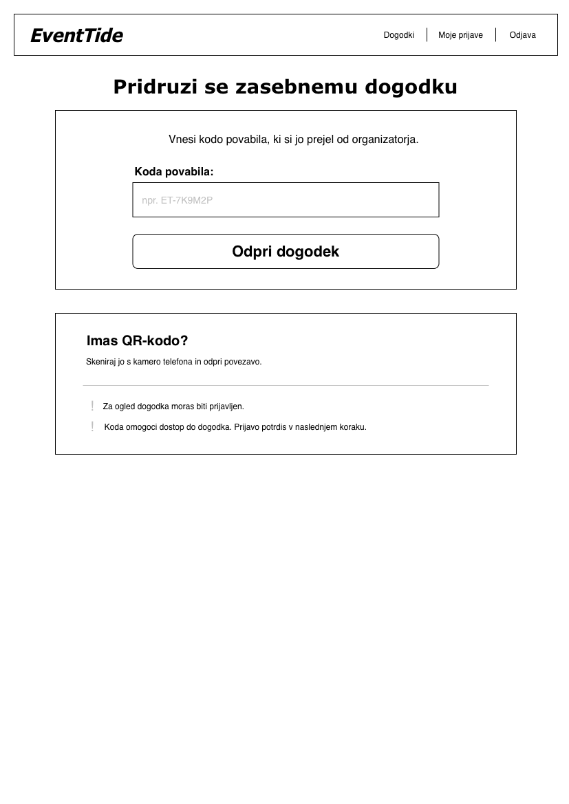

# EventTide – wireframe-i

Skice prikazujejo osnovno razporeditev elementov aplikacije.

## 1. Seznam dogodkov

Zaslon prikazuje javne prihajajoče dogodke, iskanje po naslovu ter filtriranje po kategoriji in datumu. Uporabnik lahko odpre podrobnosti dogodka ali izbere dostop do zasebnega dogodka.

**Povezane zgodbe:** US-02, US-17.

## 2. Podrobnosti dogodka

Zaslon prikazuje opis dogodka, lokacijo, termin, rok za prijavo in prosta mesta. Uporabnik se lahko prijavi na dogodek oziroma se ob zapolnjeni kapaciteti uvrsti na čakalni seznam.

**Povezane zgodbe:** US-03, US-04.

## 3. Pregled prijav in prisotnosti

Organizator vidi potrjene udeležence in urejen čakalni seznam svojega dogodka. Od začetka dogodka lahko pri potrjenih udeležencih označi in shrani prisotnost.

**Povezana zgodba:** US-07.

## 4. Dostop do zasebnega dogodka

Uporabnik vnese kodo povabila in odpre zaseben dogodek. QR-kodo lahko skenira s kamero telefona, s čimer odpre povezavo do dogodka. Za ogled se mora prijaviti v račun, prijavo na dogodek pa potrdi posebej.

**Povezana zgodba:** US-17. Zasebni dogodki so predvideni kot nadgradnja zunaj MVP.